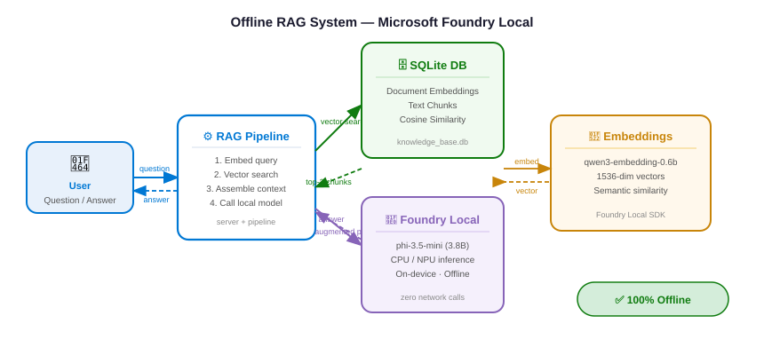
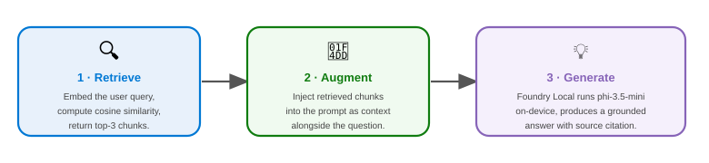

# 📚 Local RAG Assistant

**Offline document Q&A powered by Microsoft Foundry Local**

[](https://python.org)
[](https://streamlit.io)
[](https://learn.microsoft.com/foundry-local)
[](https://sqlite.org)
[](LICENSE)

> A fully **offline** Q&A assistant that answers questions from your own documents —
> no internet, no cloud account, no data leaving your device.

---

## 🏛️ System Architecture



The entire pipeline runs on a single machine. The user's question is embedded locally, matched against a SQLite vector database, and sent to a Foundry Local LLM together with the retrieved context. The answer is generated entirely on-device.

---

## 🔄 RAG Pipeline — 3 Steps



| Step | What happens |
| ---- | ------------ |
| **1 · Retrieve** | User question → embedding vector → cosine similarity search → top-3 document chunks |
| **2 · Augment** | Retrieved chunks injected into the LLM prompt as context alongside the question |
| **3 · Generate** | `phi-3.5-mini` runs on-device via Foundry Local, produces a grounded, cited answer |

---

## ✨ Key Features

- **100% offline** — no API keys, no internet required after model download
- **Any documents** — drop `.txt` or `.md` files into `docs/` and re-run ingestion
- **Source citations** — every answer references the document it came from
- **No hallucination by design** — model is constrained to retrieved context only
- **Two interfaces** — Streamlit web UI and interactive CLI (`main.py`)
- **Functional test suite** — 9 automated tests covering in-scope and out-of-scope queries

---

## 🛠️ Tech Stack

| Component | Technology | Role |
| --------- | ---------- | ---- |
| **On-device LLM runtime** | Microsoft Foundry Local | Runs models locally, zero network calls |
| **Chat model** | `phi-3.5-mini` (3.8 B params) | Generates answers from retrieved context |
| **Embedding model** | `qwen3-embedding-0.6b` | Converts text → 1536-dim vectors |
| **Vector store** | SQLite + NumPy | Stores & searches document embeddings |
| **Web UI** | Streamlit | Chat interface with source inspection |
| **Chunking** | Sentence-boundary splitter | 500-char overlapping passages |
| **Similarity** | Cosine similarity | Ranks chunks by semantic relevance |

---

## 📁 Project Structure

```text
local-rag-assistant/
│
├── app.py               # Streamlit web UI (Chat + How It Works tabs)
├── main.py              # Interactive CLI
├── ingest.py            # Document ingestion pipeline
│
├── config.py            # Model aliases, paths, chunk & retrieval settings
├── foundry_manager.py   # Singleton wrapper — initialises Foundry Local once
├── database.py          # SQLite: init, insert, query, count, clear
├── embeddings.py        # Foundry Local embedding client + cosine similarity
├── retrieval.py         # get_top_chunks() — semantic vector search
├── llm_client.py        # answer_query() — full RAG pipeline
│
├── test_rag.py          # Functional test suite (9 test cases)
├── requirements.txt     # Python dependencies
├── .gitignore
│
├── assets/
│   ├── architecture.svg # System architecture diagram
│   └── rag-pipeline.svg # RAG 3-step pipeline diagram
│
└── docs/                # Knowledge-base source documents
    ├── ai_fundamentals.txt
    ├── embeddings_and_vector_search.txt
    ├── foundry_local_guide.txt
    ├── prompt_engineering.txt
    ├── python_basics.txt
    ├── rag_explained.txt
    └── sqlite_guide.txt
```

---

## 🚀 Quick Start

### 1 · Install Foundry Local

Download the Foundry Local installer from the Microsoft documentation page and verify:

```bash
foundry-local --version
```

### 2 · Clone the repository

```bash
git clone https://github.com/EnesErdogans/Local-RAG-Assistant.git
cd Local-RAG-Assistant
```

### 3 · Create a virtual environment

```bash
# Windows
python -m venv .venv
.venv\Scripts\activate

# macOS / Linux
python -m venv .venv
source .venv/bin/activate
```

### 4 · Install dependencies

```bash
pip install -r requirements.txt
```

> On first run, Foundry Local automatically downloads the required models
> (`qwen3-embedding-0.6b` ~0.6 GB and `phi-3.5-mini` ~2.4 GB).

### 5 · Add your documents

Place `.txt` or `.md` files in the `docs/` folder.
Seven sample documents are already included.

### 6 · Ingest documents

```bash
python ingest.py
```

```text
=== Local RAG Assistant - Ingestion Pipeline ===

Found 7 document(s) in 'docs/':
  [ai_fundamentals.txt]    -> 11 chunks stored
  [rag_explained.txt]      ->  8 chunks stored
  ...
  DB total: 64 chunks
```

### 7 · Run the assistant

**Streamlit web UI (recommended):**

```bash
streamlit run app.py
```

Then open <http://localhost:8501> in your browser.

**Command-line interface:**

```bash
python main.py
```

---

## 🧪 Running Tests

```bash
python test_rag.py
```

The test suite verifies:

- ✅ In-scope questions receive relevant, keyword-matched answers
- ✅ Out-of-scope questions are gracefully declined ("I don't have that information")

```text
=== RAG Assistant — Functional Tests (9 cases) ===

[01] What are the three steps of RAG?       PASS — sources: rag_explained.txt
[02] What is Foundry Local?                 PASS — sources: foundry_local_guide.txt
[03] How is cosine similarity calculated?   PASS — sources: embeddings_and_vector_search.txt
...
Results: 9 passed / 0 failed / 9 total
```

---

## ⚙️ Configuration

All settings are in [`config.py`](config.py):

| Setting | Default | Description |
| ------- | ------- | ----------- |
| `EMBEDDING_MODEL` | `qwen3-embedding-0.6b` | Foundry Local embedding model alias |
| `CHAT_MODEL` | `phi-3.5-mini` | Foundry Local chat model alias |
| `CHUNK_SIZE` | `500` | Max characters per document chunk |
| `CHUNK_OVERLAP` | `80` | Overlap between consecutive chunks |
| `TOP_K_CHUNKS` | `3` | Number of chunks retrieved per query |
| `MAX_TOKENS` | `512` | Max tokens in the LLM response |
| `TEMPERATURE` | `0.1` | Low = more factual, deterministic answers |

---

## 💡 How It Works — Deep Dive

### Ingestion phase *(run once)*

```text
docs/*.txt
    │
    ▼ chunk_text()          sentence-boundary splitting, 500 chars, 80-char overlap
    │
    ▼ get_embedding()       qwen3-embedding-0.6b → 1536-float vector per chunk
    │
    ▼ insert_chunk()        (source, chunk_index, content, embedding) → SQLite
```

### Query phase *(per question)*

```text
User question
    │
    ▼ get_embedding()       same embedding model → query vector
    │
    ▼ cosine_similarity()   query vector vs every stored chunk vector
    │
    ▼ top-3 chunks          highest similarity scores selected
    │
    ▼ format_context()      chunks assembled into [Source: ...] context string
    │
    ▼ complete_chat()       system prompt + context + question → phi-3.5-mini
    │
    ▼ answer + sources      returned to UI
```

### Why SQLite?

SQLite requires **no server, no setup** — it's a single file (`knowledge_base.db`).
For this project's scale (< 1 000 chunks), brute-force cosine similarity in NumPy runs in under 50 ms, making a specialised vector database unnecessary.

### Why RAG over fine-tuning?

| | RAG | Fine-tuning |
| - | --- | ----------- |
| **Update knowledge** | Add files, re-ingest | Re-train the model |
| **Source citations** | Built-in | Not available |
| **Cost** | Free (local) | GPU hours |
| **Hallucination risk** | Low — constrained to context | Higher |
| **Custom docs** | Any `.txt`/`.md` file | Requires training data prep |

---

## 📋 System Requirements

| | Minimum | Recommended |
| - | ------- | ----------- |
| **OS** | Windows 10 / macOS 12 | Windows 11 / macOS 14 |
| **RAM** | 8 GB | 16 GB |
| **Disk** | 10 GB free | 20 GB free |
| **GPU** | Not required | Any DirectX 12 GPU |
| **Python** | 3.11 | 3.13 |

---

## 🗺️ Roadmap

- [ ] PDF and DOCX document support
- [ ] Streaming responses in the Streamlit UI
- [ ] Conversation history (multi-turn memory)
- [ ] Re-ranking retrieved chunks with a cross-encoder
- [ ] Configurable model selection from the UI

---

## 👤 Author

**Enes Erdogan**
[GitHub](https://github.com/EnesErdogans) · [Email](mailto:eeneserdogan50@gmail.com)

---

## 📄 License

This project is licensed under the MIT License.

---

*Built as part of the Microsoft Summer School — Foundry Local Programme.*
